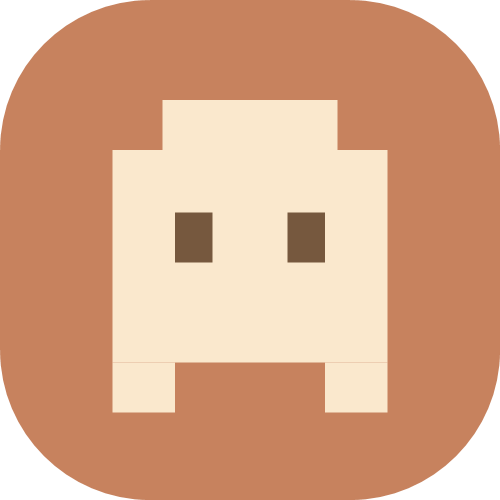
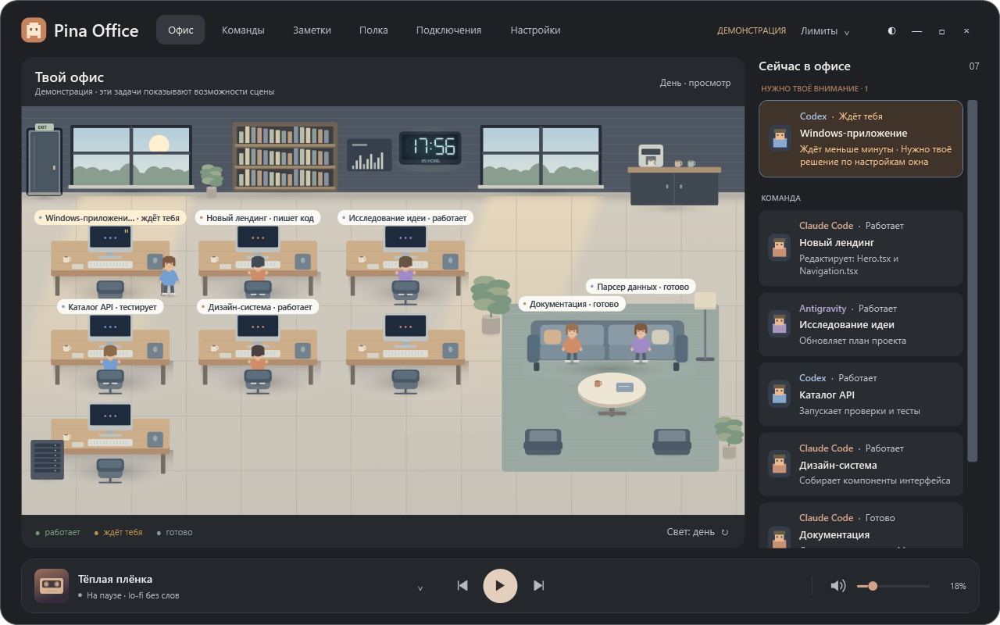
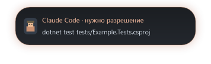
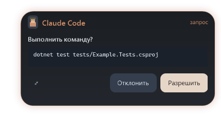
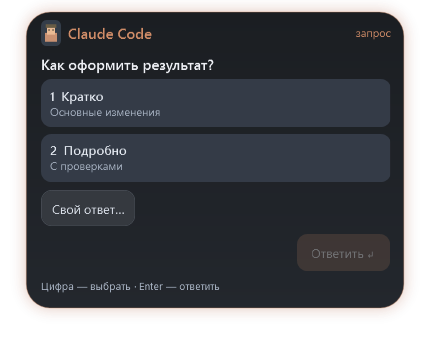
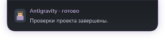
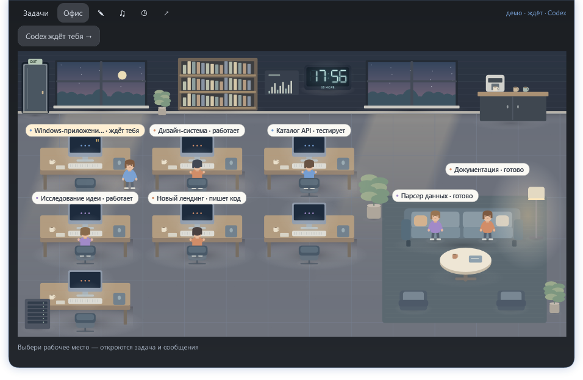
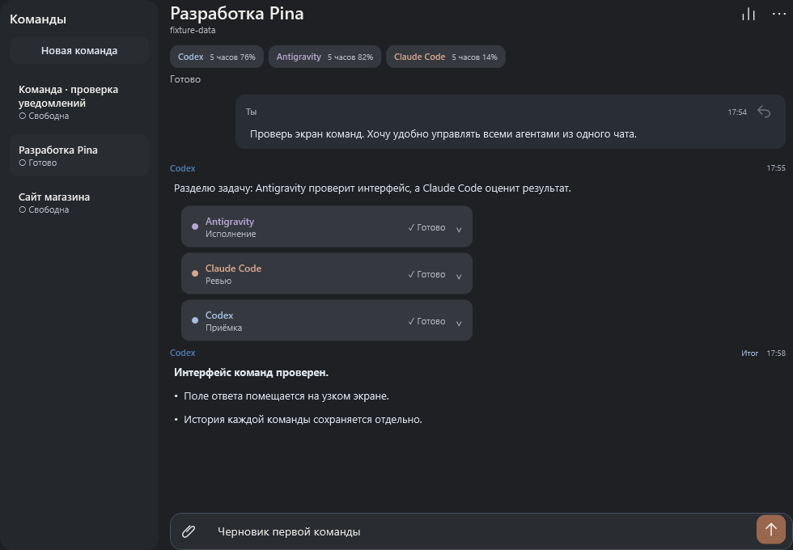

<h1 align="center">Pina Office</h1>

<strong>Тихий офис для ИИ-агентов на Windows</strong> Codex, Claude Code и Antigravity в одном месте.

<a href="https://github.com/use-pina/pina-office/releases"><strong>Скачать для Windows</strong></a> · <a href="https://github.com/use-pina/pina-office/issues">Сообщить о проблеме</a>

Windows 10 (2004+) и Windows 11 · x64 · версия 2.0.1

Pina показывает, кто работает, где ждут твоего ответа и что уже готово. Офис можно оставить рядом с редактором. Для коротких уведомлений подойдут капсула, плавающий значок, панель у края или значок в трее.

## Чёлка, которая показывает главное

Пока агенты заняты, панель занимает немного места у края экрана. Когда нужен ответ, она показывает имя агента и коротко объясняет запрос. Цвет помогает отличить Codex, Claude Code и Antigravity.

**Наведись, чтобы ответить.** Панель раскроется до короткой карточки с командой и кнопками решения. После ответа она свернётся. Вопрос с вариантами можно раскрыть там же, выбрать ответ или написать свой.

<table>
<tr>
<td width="50%" align="center"><strong>Разрешить команду</strong></td>
<td width="50%" align="center"><strong>Ответить на вопрос</strong></td>
</tr>
<tr>
<td width="50%" align="center"></td>
<td width="50%" align="center"></td>
</tr>
</table>

В полной карточке доступны дополнительные параметры разрешений. Можно разрешить конкретную команду для текущей сессии или включить автоподтверждение с предупреждением. Вопросы с вариантами остаются за тобой.

**Готовый результат тоже появится рядом.** Наведи курсор и прочитай, что сделал агент. После просмотра подсветка снимается. Если разрешение уже обработано, Pina убирает его карточку.

## Подстрой панель под свой экран

| Форма | Как выглядит и открывается |
| --- | --- |
| **Чёлка** | Панель прилегает к краю экрана и раскрывается внутрь. Доступен прозрачный режим с пропуском кликов. |
| **Капсула** | Небольшая панель с отступом от края. Показывает короткий статус и раскрывается при наведении или щелчке. |
| **Плавающий значок** | Круглый индикатор для тех, кто хочет освободить больше места. Запрос открывается из значка. |
| **В трее** | Pina доступна из области уведомлений Windows. Панель открывается по вызову. |

Перетащи панель за свободное место в шапке к удобному краю. Положение также выбирается в настройках, включая другой монитор. Можно включить скрытие в тишине и отдельно настроить раскрытие при наведении.

Для вызова подойдут два Shift, два Ctrl или своё сочетание. Выбери, что открывать по клавише — последний экран, офис или задачи. Ожидающий ответ или непрочитанный результат получит приоритет.

## Офис, заметка и музыка под рукой

Из раскрытой панели можно посмотреть рабочие места агентов, открыть задачу и вернуться обратно. Быстрая заметка сохраняется в выбранный проект, а плеер позволяет поставить музыку на паузу и изменить громкость.

Иллюстрации показывают интерфейс на демонстрационных задачах.

## Команды в одном чате

Собери команду для проекта и выбери, кто составляет план, выполняет задачу и проверяет результат. Напиши ведущему. Передачи между агентами, разрешения и итог появятся в одном разговоре. Карточку участника можно раскрыть и прочитать его отчёт.

- **Расход по задачам.** Пятичасовой и недельный лимиты по замерам аккаунтов, токены по агентам и детализация каждого обращения.
- **Запросы под рукой.** Ответь на доступный вопрос агента или реши, разрешать ли команду, прямо из панели.
- **Заметки по проектам.** Быстрые записи, дневник и хронология работы. Можно сохранить их в Obsidian или локальную папку.
- **Офис на свой вкус.** Выбери тему, положение панели и горячую клавишу. Включи музыку Pina или управляй системным плеером Windows.

## Что нового в 2.0.1

[Pina Office 2.0.1](https://github.com/use-pina/pina-office/releases/tag/v2.0.1) превращает окно команд в удобную рабочую среду: поиск по чатам, меню по правому клику, переименование на месте и аккуратная панель инструментов. Для Claude Code видны настоящие модели аккаунта, например Opus 5.5 и Fable 5.1. Плеер переключается плавно, а кнопки стали компактнее.

История всех изменений — на [странице выпусков](https://github.com/use-pina/pina-office/releases).

## Установка и обновления

1. Скачай `PinaOffice-Setup-…exe` со страницы выпусков. Рядом есть переносной ZIP. [Выпуски Pina Office](https://github.com/use-pina/pina-office/releases)
2. Запусти установщик и выбери папку. Всё необходимое уже в пакете. Установка доступна для текущего пользователя Windows.
3. В мастере выбери вид панели и клавиши. Во вкладке **Подключения** настрой нужных агентов. Pina работает с твоими существующими аккаунтами Codex, Claude Code и Antigravity.

Если у тебя сборка со старым адресом обновлений, один раз установи предрелиз из этого репозитория. В **Настройки → О приложении** можно включить автообновление: перед открытием офиса установленная Pina проверит и установит новую версию. Без сети откроется текущая. Во время работы проверка повторяется каждые 10 минут. Переносная сборка обновляется вручную.

## Обратная связь

Возможности ответов зависят от версии агента и доступного канала. Вопросы Codex Desktop без внешнего канала ответа завершаются в Codex. Контрольные суммы готовых файлов и памятка тестеру находятся рядом с установщиком.

Приложение хранит настройки, черновики и историю работы локально. Диагностику для разбора ошибки можно отдельно включить, сохранить архив и передать вручную.

Что содержат архивы Source code на GitHub

GitHub формирует их автоматически из этого репозитория. В нём опубликованы описание и иллюстрации. Готовая программа доступна в установщике и переносном ZIP.

---

**Pina** · инструменты для работы с ИИ-агентами. [Профиль бренда](https://github.com/use-pina)
